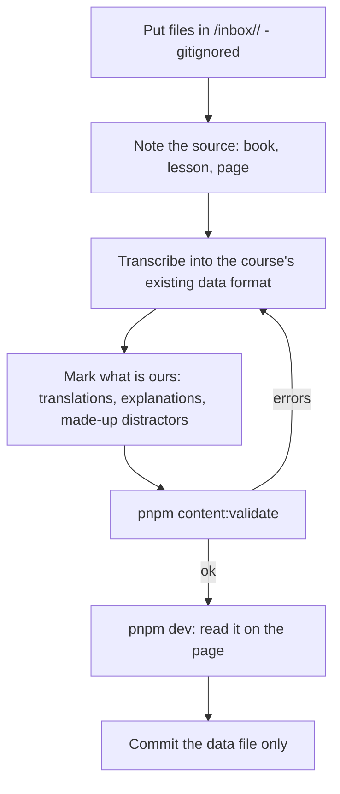

# Adding new material (PDF, photo, screenshot, handout)

The aim is to turn source material into content files that are checked and committed, without ever committing the source itself.



## Rules

1. **The original Japanese is copied, not rewritten.** If a word cannot be read, write `[?]` and leave the answer empty, rather than guessing.
2. **No invented answers.**
   - If the material has no answer key, the question goes in without one.
   - The validator then warns about it.
   - Test pages must not use such a question until the key is known.
3. **Generated material is labelled.**
   - This covers Turkish and English translations, explanations, and extra practice questions.
   - Mark it in the file with a comment.
   - The convention is already used in `blue-book/data.ts` and `business-nihongo/data.ts`.
4. **Keep the source reference** (book, lesson, page) in the lesson's title or a comment.
5. **Never commit** the PDF, the photo or past-exam text.
   - Copyrighted past papers stay in `/assets/past-n3/`, which is gitignored.
6. **URLs and test ids never change.**
   - `content/keys.lock.json` records every page URL.
   - The validator fails if one disappears.
   - Run `node scripts/content-validate.ts --update-lock` only when adding a page.

## Where each kind of material goes

| Material | File | Format |
|---|---|---|
| Textbook lesson (Blue Book, Business Nihongo) | `src/pages/<course>/data.ts` | `Lesson` (`src/components/textbook/types.ts`) |
| Matsuya words, menu, dialogues | `src/pages/matsuya/data.json`, `menu.ts`, `work.ts` | existing shapes |
| Kanji (Kanji Book 2, radicals) | `src/pages/kanji-book-2/data.json`, `radikaller/data.json` | existing shapes |
| N5 / N4 grammar pages | `legacy/<n5\|n4>/index.html`, then `pnpm extract` | legacy HTML, which is the source of the data.json |
| Past JLPT paper (private) | `assets/past-n3/app/<yyyy-mm>.*.ts` plus `audio/<yyyy-mm>.mp3` | `Exam` (`src/pages/past-n3/types.ts`). Listening questions need `start` (seconds) |
| New course | `src/pages/<path>/index.vue` plus an entry in `src/site.ts` | then run `--update-lock` |

## Checks to run

```sh
pnpm content:validate   # answers in range, no duplicate options, balanced notation, no script HTML, URLs kept
pnpm test               # engine and storage tests
pnpm build              # type-check plus prerender
```
