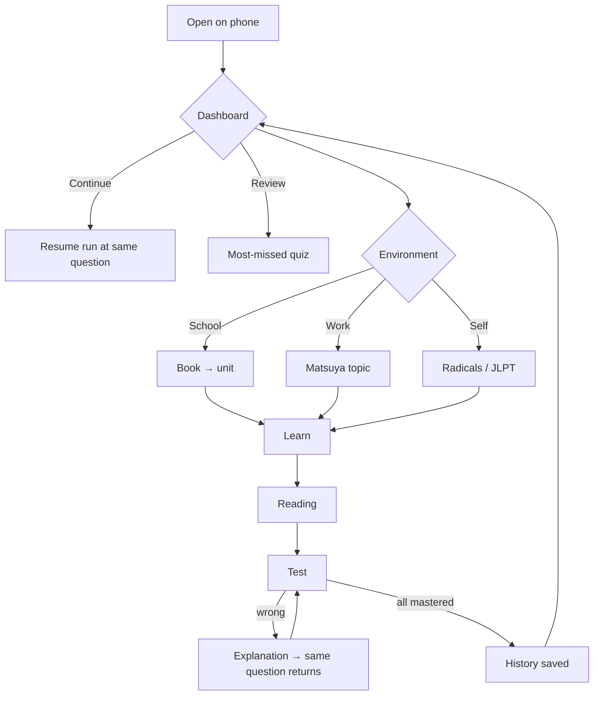
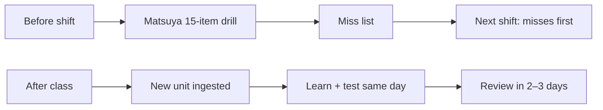
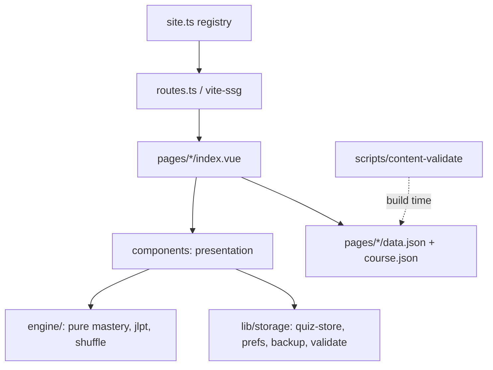
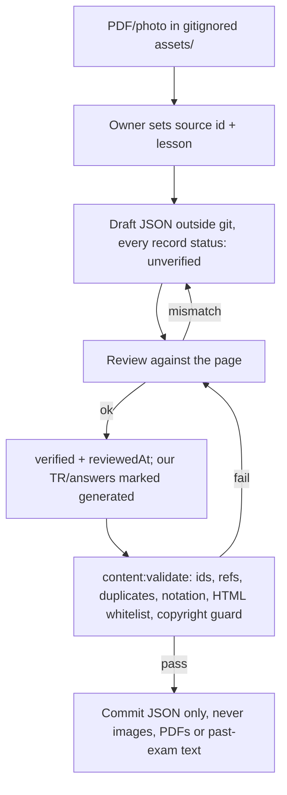

# NIHONGO: Consolidated Blueprint (proposal, awaiting owner approval)

Date: 2026-11-14.

How this was made:
- Seven specialist reviews (product, software, learning, UI/UX, data, QA/security, performance/deploy), each done independently and read-only.
- The reviews were consolidated by the lead. Each reviewer verified the existing ARCHITECTURE.md, DATA_MODEL.md and PLAN.md against the code.
- Nothing in the application has been changed.

Decision labels: **A** = approved · **AC** = approved with conditions · **INV** = needs investigation · **R** = rejected · **OWNER** = needs the owner's choice.

---

## 1. Executive summary

The app is in better shape than a rewrite would assume:
- There is already one quiz engine.
- Routes are data-driven.
- Content is split per page.
- A no-flash theme script exists.
- The type-check is green.

The real risks are:
1. Progress lives only in localStorage, with no backup, no validation on load and no tests.
2. The mastery rules cannot be tested while they live inside a 537-line component.
3. A future import or ingestion would feed untrusted strings into `v-html`.
4. Small deploy hazards: copyrighted audio can reach a local `dist/`, there is no 404 page, and fonts produce about 500 files.

The plan is incremental:
- Make progress safe first.
- Then pin the algorithm with tests and extract it.
- Then unify the UI strings.
- Only after that build the dashboard, the Learn/Reading/Test pattern and the content tooling.

No backend, no database and no UI framework change.

## 2. Current application assessment (verified)

| Area | Finding | Source |
|---|---|---|
| Routing/SSG | `routes.ts` globs `pages/**/index.vue`; `includedRoutes = sitePaths`; base from `VITE_BASE` | software, perf |
| Engine | All 6 established rules hold exactly (MasteryQuiz.vue:192–257) | learning |
| Progress keys | `nihongo-run:*`, `nihongo-history:*`, plus **undocumented** `nihongo-left:<path>` (sessionStorage), `nihongo-radikaller:lesson`, `nihongo-theme`, prefs | software |
| Load safety | `SavedRun` is parsed and cast without shape checks. A malformed run throws on mount every visit, so the page is **bricked** until storage is cleared | QA |
| Resume | Resume compares the pool only. Changed content under the same ids resumes a stale question | learning, QA |
| History | Capped silently at 50 attempts (quiz-store.ts:93) | QA |
| i18n | Typed dictionaries in `i18n.ts`. Strings are also scattered in `S` (QuizHistory) and `U` (radikaller). `vue-i18n` is installed but unused. `zh` remains in `Lang`, `prefs.ts` and `n4/13-15` | software |
| Theme | Pre-paint script exists (index.html:7–16). There is a first-visit flash on a dark OS, because a `null` stored value is not treated as `system`. The UI only offers 2 states. No `color-scheme` or `theme-color` meta | UI |
| Layout | Fixed footer has no safe-area handling and eats quiz space. Info and back buttons are 32/40 px, below the 44 px target. The toast can overflow at 360 px | UI |
| XSS surface | About 25 `v-html` sites through `notation()`, which does no escaping. Safe today because all strings come from the repo | QA |
| Bundle | Page chunks are lazy (n5 222 KB is the largest). CSS is 422 KB raw and unmeasured gzipped. 493 font files (woff and woff2 duplicates). No `404.html` | perf |
| Copyright | A local `dist/` contains 35 MB of past-exam MP3s. CI builds without them, so the live site is unaffected | perf |
| Data shapes | Heterogeneous: `a`/`ans`, `exp`/`why`/`tip`/`tn`, string vs array `on`, raw HTML blocks in n4/n5. ARCHITECTURE.md §1 "used by 6 pages" is **correct** (6 page files import MasteryQuiz) | data, lead |

Corrections to the existing docs:
- The theme script already exists. Only the `null` case is missing.
- The progress key list is incomplete.
- The envelope migration is replaced (see §9).

## 3. Product requirements

**Must**
1. **M1. Progress backup.** Export and import, with validation and a preview.
2. **M2. Tested, extracted engine** with identical behaviour.
3. **M3. Dashboard:** a Continue card, plus progress per environment.
4. **M4. Consistent Learn / Reading / Test tabs.** A tab only appears when content exists for it.

**Should**
1. **S1. Weak-item review:** a quiz drawn from the most-missed items.
2. **S2. Per-option wrong-answer explanations,** shown only where data exists.
3. **S3. Content validator.**
4. **S4. Single TR/EN string source.**

**Could**
1. **C1.** Day streak.
2. **C2.** Spaced review (Leitner).
3. **C3.** 5-minute pre-shift Matsuya drill.
4. **C4.** TTS audio.

Acceptance criteria are taken from the product report, each measurable:
- **Export/import:** deep-equal round trip.
- **Tests:** 16 or more cases green.
- **Continue card:** opens the same question; absent when there is no data.
- **Pages:** no empty tabs, no horizontal scroll at 360 px.
- **Build:** fails on a duplicate id.

## 4. User journeys





## 5. Target architecture



Rules:
- `engine/` never touches `window` or Vue.
- All storage access goes through `lib/storage`.
- Components hold no business rules.

## 6. Directory structure (target)

```
src/
  site.ts  routes.ts  main.ts
  engine/        mastery.ts  mastery.test.ts  jlpt.ts  kanji-similar.ts  shuffle.ts
  lib/storage/   quiz-store.ts  prefs.ts  backup.ts  validate.ts
  lib/           i18n.ts  ruby.ts  page.ts  paged.ts  test-route.ts  error-bar.ts
  components/    (unchanged structure; textbook/, guide/)
  pages/<path>/  index.vue  data.json  course.json   ← data stays here
scripts/         content-validate.ts
planning/        (this folder; not part of the app)
```

**AC.** Do not move data into `src/content/` now. Consider it only if the number of courses grows a lot (data and software reviews agree).

## 7. Content data model (amendments to DATA_MODEL.md)

- **A: two id namespaces.** Content ids are `<course>:<kind>:<natural-key>` with a `legacyId` alias. Test/progress keys (`rad15-N`, `kan15-N`, `kb2:u<n>`, textbook `path+lesson.id`) are **opaque, frozen strings**, declared in `course.json` and locked in `keys.lock.json`. The build fails if a key disappears.
- **A: new record kinds.**
  - `Unit`: an ordered list of child ids, for textbook lessons.
  - `Article`: raw blocks, for the n4/n5 HTML. It is never forced into Vocab or Grammar.
- **A: status per field group.**
  - `status` is `verified`, `unverified` or `generated`.
  - `fieldStatus` covers exceptions, for example book Japanese verified but the Turkish translation generated.
  - Optional `reviewedAt`.
- **A: sources registry** in `course.json`: `{id, title, kind, license, committed}`. The `source.file` field is never a path into `assets/`.
- **A: `explain.wrong` is keyed by option text, not index.** Halving changes indices (learning review).
- **AC: field-map adapters** (`a`/`ans`, `exp`/`why`/`tip`/`tn`) instead of rewriting the data files.

## 8. Quiz engine specification

Preserved rules (locked by tests):
- Mastered at 2 correct.
- A correct answer requeues the item at index `min(len, 4–7)`.
- A wrong answer sets the count to 0, keeps the exact question in retry (the original full-option question is retained even when the miss happens on a halved showing), and requeues at `min(len, 2)`.
- When `retry.wrong >= 2`, the question is shown with the correct option plus one wrong option, re-picked on each showing.
- Options are reshuffled on every showing.
- A wrong answer resets the streak. `best` is the maximum streak.

API (`engine/mastery.ts`, pure, arrays not Maps, state == `SavedRun` minus `at`):
- Functions: `start`, `next`, `answer → {state, outcome}`, `halve`, `progress`, `fromSaved`, `toSaved`.
- `rng` is injected.

**AC conditions:**
1. Characterization tests are written and green against the current component **before** the extraction.
2. The component keeps its UI state in a `shallowRef` replaced per event, so the animations are driven by `outcome`. This addresses QA's reactivity risk.
3. The `SavedRun` shape stays byte-compatible. A real old saved run is used as a test fixture.

Known edge cases, documented and not changed:
- When 0–1 items are left, a missed item comes straight back.
- `accuracy` is overall correctness, not "first try". This is a naming fix only.

**OWNER: spaced repetition.** Proposed only as a separate review mode that chooses the pool. The rules inside a run are unchanged.

## 9. Progress persistence specification

**Disagreement:** DATA_MODEL.md proposed a single versioned envelope. The software and QA reviews both object: moving keys adds data-loss risk with no visible benefit.

**Decision: R** for the envelope migration. **A** for:
- **Keep the keys.** All existing keys stay exactly as they are. Add a `nihongo-schema: 1` marker.
- **Validate on load.** `validate.ts` checks the shape of every run. A bad run is discarded on its own, with a notice, and is never thrown.
- **Export.** Every `nihongo-*` key goes into one JSON file. The file is built from memory, so export still works when storage is blocked. iOS gets a copy-to-clipboard fallback.
- **Import.**
  - Show a preview first (counts, newest date). The user chooses merge or replace.
  - Back up to `nihongo-backup-<date>` before applying anything.
  - Merge history by `at` with deduplication.
  - Reject the file if any of these hold:
    - its version is unknown;
    - it is larger than 2 MB;
    - it has `__proto__`/`constructor` keys;
    - it has keys outside `^[\w./:-]{1,200}$`;
    - it has strings containing `<` or `>` in labels or paths.
- **Write failures.** Quota or write errors are shown once, not swallowed.
- **AC: history cap.** Keep the cap of 50 but make it explicit. Import must respect it.
- **AC: stored `zh`.** A stored `zh` language falls back to `tr`.

## 10. Localization architecture

- **A:** keep the typed dictionaries in `i18n.ts`. Interface languages are `tr` and `en`, and a missing key is a compile error.
- **A:** move `S` (QuizHistory), `U` (radikaller) and the ReadingLesson literals into `i18n.ts`.
- **A, after verifying the build:** remove `vue-i18n`.
- **A:** split the types. `UiLang = 'tr' | 'en'`. `ContentLang` is declared per page in `site.ts`, so n4/13-15 keeps its `zh` content.

## 11. Theme and design system

- **A:** a 3-way theme control (System, Light, Dark) as a `SegmentedControl` in Settings. The header quick toggle stays.
- **A:** fix the first-visit flash (`s === null` means system). Add `color-scheme` and the two `theme-color` metas.
- **A:** type-scale tokens in `main.css @theme`, replacing ad-hoc `text-[1.6rem]` values. Furigana `rt` uses `max(0.55em, 10px)`.
- **A:** keep rei-kit roles only, run a contrast check in dark mode, and never invent component APIs.

## 12. Mobile UI specifications

- **A:** touch targets of at least 44 px (StudyHeader back/info). Safe-area padding. Toast at `max-w-[calc(100vw-32px)]` with wrapping.
- **A:** the fixed footer credit moves into Settings/About.
- **OWNER: navigation.** The UI review proposes a 4-tab rei-kit `TabBar` (Home, Library, Practice, Settings), hidden during tests. The product review stresses simplicity. Lead recommendation: start with the dashboard plus the existing header menu, and add the TabBar only if navigation still feels slow.
- **A:** dashboard at 360 px:
  - Continue card with a ring;
  - 3 stat cards (streak, accuracy, mastered);
  - a review row;
  - 3 environment tiles with progress bars.
- **A:** Learn/Reading/Test is a `SegmentedControl` held in the URL query. Labels are at most 8 characters.
- **A, accessibility:**
  - Focus moves to the feedback after an answer.
  - Sheets get focus trap and Esc.
  - `buzz` and smooth scroll respect reduced motion.
  - Veiled answers are hidden from screen readers until revealed.
  - Emoji flags are replaced.

## 13. Content ingestion workflow



- Generated practice questions are always `status: 'generated'` and are labelled as such in the UI.
- Questions with no answer key are excluded from tests and listed as warnings.

## 14. Data validation strategy

`scripts/content-validate.ts` runs before the build as a node script. It checks:
- ids are unique;
- references resolve;
- the answer is in range and options have no duplicates;
- notation is balanced and readings are kana only;
- declared languages are present (warnings only);
- `keys.lock.json` has no removed test key;
- HTML is limited to a whitelist (`ruby rt mark u b i br span`), with no handlers or `javascript:`;
- copyright guard: no `assets/past-n3` paths or past-exam fields in tracked files.

Errors fail the build and warnings are printed.

Duplicates:
- Within a course, a duplicate is an error.
- Across courses, it is a warning (shared words are legitimate).
- Same prompt with different answers is flagged as a conflict.

## 15. Testing strategy

- **Unit tests:** `vitest`, as a dev dependency only, with a Node environment and no jsdom. A small in-memory Storage stub replaces localStorage.
- **Engine tests:** the 16 learning-review cases (see learning report §3), plus a property test: random answer sequences always terminate with every item mastered.
- **Storage tests:**
  - validation against corrupt fixtures (`{"pool":[]}`, `[]`, `"x"`);
  - import with a hostile file;
  - migration run twice.
- **Pure helper tests:** `groupMisses`, `accuracy`, `runProgress`, `notation`, `halve`.
- **Smoke:** `pnpm build` (SSG), plus a golden list of storage keys and route URLs.
- **E2E:** optional, a single Playwright smoke run locally (no new dependency in the repo).

## 16. Security and reliability

| Risk | Severity | Decision |
|---|---|---|
| Corrupt saved run bricks a page | High | **A**, ship first |
| Imported history → `v-html` XSS (MissList labels, `run.question`) | High once import ships | **A**: validate imports; render labels with text interpolation |
| Ingested content → `v-html` | Medium | **A**: whitelist in the validator |
| Silent quota or write failure | Medium | **A**: one-time notice |
| Safari 7-day storage eviction | Medium | **A**: backup reminder after 14 days |
| Two tabs on the same test overwrite each other | Low | Documented, not fixed |
| CSP meta | Low | **INV**: only after import or ingestion ships |
| Syntax newer than safari14 (`structuredClone`, `.at`, `Object.hasOwn`) | Medium | **A**: lint rule or review rule |

## 17. Performance and deployment

- **A:** a CI guard after the build fails when any of these is true:
  - `dist` contains `.mp3` or `.pdf`;
  - `dist/404.html` is missing;
  - `dist/index.html` lacks the repo base.

  These three cover the three past incidents.
- **AC: past-n3 data.** Gate it behind `VITE_PAST_N3=1`, off by default. This keeps copyrighted audio out of every non-local build.
- **A:** generate a `404.html` that links home.
- **A:** on the `vite:preloadError` event, reload once, to survive stale HTML after a deploy.
- **AC: fonts.** Drop the legacy `woff` files, keeping `woff2` only. This roughly halves the file count. Measure before and after.
- **INV:** gzipped CSS size, and whether all 10 palettes are needed on every page.
- **R:** fetching JSON at runtime or splitting N5/N4 data now. SSG needs the data at render time, and current sizes are acceptable.

## 18. Agent responsibilities and operating protocol

The agent definitions live in user-level agent definitions, at user level, never in the repo:

| Agent | Model |
|---|---|
| product-architect | opus |
| software-architect | opus |
| learning-engineer | opus |
| ui-ux-designer | sonnet |
| data-architect | sonnet |
| qa-security-engineer | sonnet |
| performance-deployment-engineer | sonnet |

- All agents are read-only advisors.
- The lead (main session) is the only one who edits files or decides anything.
- Each implementation step has one owner. QA and the relevant specialist review the step before it is accepted.
- Recommendations follow the decision format and carry a confidence level.

## 19. Prioritized roadmap

Each step is a separate, individually revertible commit, and `pnpm build` is green after every step.

| # | Step | Depends on |
|---|---|---|
| 1 | Run validation on load (fixes the page-bricking risk) + add vitest | – |
| 2 | Characterization tests for the current MasteryQuiz | 1 |
| 3 | Extract `engine/mastery.ts`; the same tests pass | 2 |
| 4 | Export/import with validator, preview, backup; `nihongo-schema` marker | 1 |
| 5 | CI guards, 404.html, preloadError reload, past-n3 flag, woff2 only | – |
| 6 | Theme 3-way + flash fix + metas; touch targets, safe area, toast, footer move | – |
| 7 | i18n consolidation, UiLang/ContentLang split, remove vue-i18n | – |
| 8 | Dashboard (Continue, stats, environments, review row) | 3, 4 |
| 9 | Learn/Reading/Test tab pattern; option-text explanations | 3 |
| 10 | `course.json` + sources + `keys.lock.json` + content-validate (read-only over existing data) | 7 |
| 11 | Ingestion workflow doc; add ids/legacyId to JSON courses (radikaller, matsuya, kanji-book-2) | 10 |
| 12 | Optional: review mode / spaced repetition, TabBar, Matsuya drill | owner |

Steps 1, 5, 6 and 7 are independent and can proceed in parallel, each with its own owner and on separate files.

## 20. Migration and rollback

- No storage key is renamed or deleted. Rollback means `git revert`, and old code keeps reading the same keys.
- Import always writes a `nihongo-backup-<date>` key first, and that backup can be restored.
- Data files are never rewritten wholesale. ids are added by a script that only adds fields, and the diff is reviewed.
- **OWNER, before step 11:** is `scripts/extract-legacy.ts` still used? If it is, it would overwrite the added fields, so it must either be made to emit them or be frozen.
- A test key that disappears fails the build (`keys.lock.json`).

---

## Decisions requiring owner approval

1. **Persistence.** Keep the per-key layout plus export/import (recommended), or use the original single-envelope plan.
2. **Navigation.** Dashboard plus header menu (recommended), or a 4-tab bottom bar.
3. **N5/N4 placement.** Stay in School, or move to Personal Study (JLPT prep).
4. **Past exams.** Confirm that the audio and data are never deployed. Keep the page on the live site as the empty notice, or remove it from the public build entirely.
5. **Spaced repetition and review mode.** This is new behaviour outside the established rules.
6. **`extract-legacy.ts`.** Still needed or frozen?
7. **`zh`.** Remove it from the interface and keep only the n4/13-15 content (recommended).
